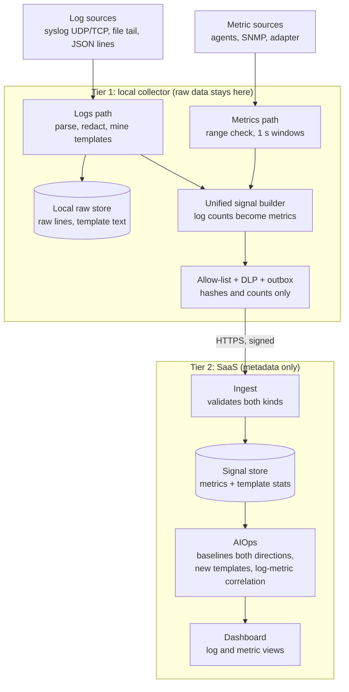
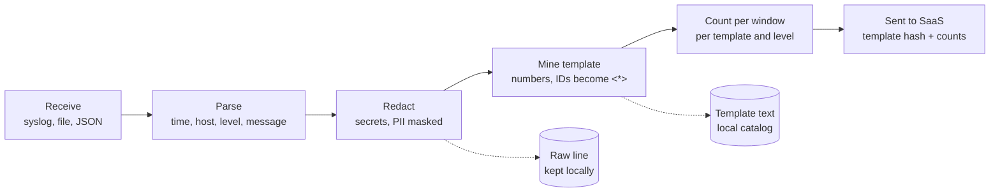

# Logs and metrics: architecture and plan

Goal: make the platform treat **log telemetry as a first-class input next to metrics**, without breaking
the rule that raw data stays local. Today metrics get the full treatment (baselines, anomalies,
correlation, health). Logs are only used to raise a few events. This document describes the target
design and the plan to get there.

## Where we are today

| | Metrics | Logs |
|---|---|---|
| Inputs | HTTP JSON, stream adapter | Syslog over UDP, HTTP JSON, stream adapter |
| Local processing | 1 s aggregation (avg, min, max, n) | Redaction, a regex-based template fingerprint, three fixed detectors |
| What leaves | Every metric, every window | Only events: `log.error_burst` (5 errors in 10 s), `log.recurring_warning` (same warning 10x in 60 s), `security.secret_in_log`, auth bursts |
| SaaS analysis | Baselines, anomaly detection, peer comparison, correlation, root cause | Each event becomes an alert; no baseline, no trend, no "new error" detection |
| Dashboard | Charts per source and metric | Nothing log-specific |

So a service whose error rate doubles, or that starts logging an exception it has never logged
before, is invisible unless it crosses one of the fixed thresholds.

## Target architecture

### The path of one log line

## Design

### Tier 1: collector

**Inputs.** Keep syslog UDP and HTTP JSON, add syslog over TCP (RFC 6587 framing) and a file tailer
(follows rotation, remembers its offset across restarts). All inputs go through one parser registry:
RFC 3164/5424 syslog, JSON lines (keys mapped by the same rules as the stream adapter), and a regex
fallback. Each parsed line becomes `{ts, host, level, message, attributes}`.

**Redaction.** Unchanged: the existing secret and PII scanner runs before anything else touches the
message. Credential findings keep raising `security.secret_in_log`.

**Template mining.** Replace the regex fingerprint with a Drain-style template miner: lines are grouped
by token count and leading tokens, and positions that vary (numbers, IDs, paths, IPs, quoted values)
become `<*>`. Example: `payment gateway timeout after 4123ms (order 8811203)` becomes
`payment gateway timeout after <*>ms (order <*>)`. Each template gets a stable ID:
`tpl-` + HMAC(local salt, template text), so the SaaS can count and compare templates without ever seeing
their text. The catalog (ID, text, first seen, level, count) is kept in the collector's SQLite and shown
on the collector console.

**Log-derived signals.** Every window, the collector turns the parsed lines into:

| Signal | Kind | Example |
|---|---|---|
| `log_lines`, `log_errors`, `log_warns` per source | metric, same pipeline as CPU | `log_errors` = 37 in this window |
| `log_error_pct` per source | metric | 4.1% of lines were errors |
| Template stats, top N per source | new record type | `tpl-3fa9c1d2`, level ERROR, count 31 |
| New template seen for the first time | event | `log.new_template`, level ERROR, count 4 |
| Source went quiet | metric drop (needs B4) | `log_lines` fell from ~60 to 0 |

The metrics flow through the existing aggregation, allow-list and outbox, so buffering, replay,
idempotency and the egress proof panel work for logs with no extra code.

**What may leave (allow-list additions).**

- metric names: `log_lines`, `log_errors`, `log_warns`, `log_error_pct`
- a `log_templates` record list with fields `source_id, ts, template_id, level, count` (no text)
- event category `log.new_template`

Template **text** never leaves by default. As an option, the customer can approve individual templates
on the collector console; an approved template's redacted text is sent once with its ID (DLP-scanned,
recorded in the egress log) so the dashboard can show a readable label. Unapproved templates show as
their hash.

### Tier 2: SaaS

**Ingest and storage.** Validate the new fields with the same strict allow-list and value checks as
metrics. Log metrics go into the existing `metrics` table. Template stats go into a new
`log_templates` table `(tenant_id, source_id, template_id, level, ts_ms, count)` with the same
event-time merge as metrics, plus a per-tenant `template_catalog` (ID, first seen, approved label).

**AIOps.**

- The existing baseline detector runs on `log_errors`, `log_error_pct` and `log_lines`, so an error-rate
  spike gets the same z-score, persistence filter and peer comparison as a CPU spike. Log volume drops
  need two-sided detection, which is bug B4.
- **New error template:** an ERROR or CRITICAL template never seen before for that *service* (across all
  its sources) raises an alert. This catches "new exception after a deploy", which counts alone miss.
- **Correlation:** log alerts join incidents by the same rules as metric alerts (same source, service
  dependency at the same site), so an incident can read "orders-db CPU saturated, then checkout-api
  started logging template `tpl-3fa9…` (`payment gateway timeout after <*>ms`) 4 s later".
- **Recommendations:** new playbook rules for error storms, new exceptions after a change, and a source
  that stopped logging. Each cites the template ID (and approved label, if any), its count against its
  baseline, and the onset time.

**Dashboard.** A Logs view per source: error rate and volume over time with the alert window shaded,
top templates by count with their trend, and new templates highlighted. The collector console gets a
template catalog with approve and revoke buttons.

### Privacy, stated plainly

| Stays local | Leaves |
|---|---|
| Raw log lines, messages, stack traces | Line, error and warning counts per window |
| Template text (unless the customer approves it) | Template IDs (HMAC hashes) with level and count |
| Usernames, IPs, hostnames inside messages | Error percentage, new-template events |
| The salt behind template IDs | Approved template labels only, redacted and DLP-scanned |

## Plan

Order and effort. Every step follows the rules in [plan.md](../plan.md): test first, one step per
commit, run the unit tests, benchmark and load test where detection or ingest changes.

| Step | Work | Depends on | Done when | Effort |
|---|---|---|---|---|
| L0 | Fix **B4** (two-sided detection) and **B18** (range checks) from `bugs.md` | - | Their tests pass | 4 h |
| L1 | Log inputs: syslog TCP, file tailer with rotation and saved offset, parser registry (syslog, JSON lines, regex) | - | Unit tests per format; a rotated file is followed without losing or repeating lines | 3 h |
| L2 | Template miner (Drain-style) and local catalog with HMAC template IDs | L1 | Variants of the same message share one ID; IDs are stable across restarts; different salts give different IDs | 3 h |
| L3 | Log-derived metrics (`log_lines`, `log_errors`, `log_warns`, `log_error_pct`) through the existing pipeline; allow-list update | L2 | Metrics appear on the SaaS per source; the egress panel shows them; no message text in any payload | 2 h |
| L4 | `log_templates` records and `log.new_template` events; SaaS validation, storage and event-time merge | L3 | Template counts stored per window; duplicates and late records handled like metrics | 3 h |
| L5 | AIOps: baselines on log metrics, new-error-template detector, log-metric correlation, playbook rules with explanations | L0, L4 | An error storm and a new exception each raise one explained alert; a DB fault and the timeout errors it causes form one incident | 4 h |
| L6 | Dashboard Logs view; collector template catalog with approve and revoke | L4 | Charts and top templates render; an approved label appears on the SaaS and in the egress log | 3 h |
| L7 | Simulator log scenarios (error storm, new exception after deploy, log silence, noisy debug burst); new `verify.py` checks; benchmark log scenarios; load test with logs | L5 | Verification passes; benchmark precision and recall stay within the current range; load test reports throughput with logs | 3 h |

**Total:** about 3 working days. A thinner first version (L0 to L3 plus the error-rate part of L5)
takes about 1.5 days and already makes error-rate spikes and log silence detectable with full
explanations.

**Risks.**

- *Template explosion:* very variable messages can create thousands of templates. Mitigation: cap the
  catalog per source, merge templates by similarity, and send only the top N per window plus a count
  of "other".
- *Payload size:* template stats add bytes per window. Mitigation: top N per source, and send a template
  only in windows where its count changed.
- *Hash dictionary attacks:* a common template's ID could be guessed by hashing known text. Mitigation:
  the HMAC salt is per collector and never leaves, the same protection as source pseudonyms.
