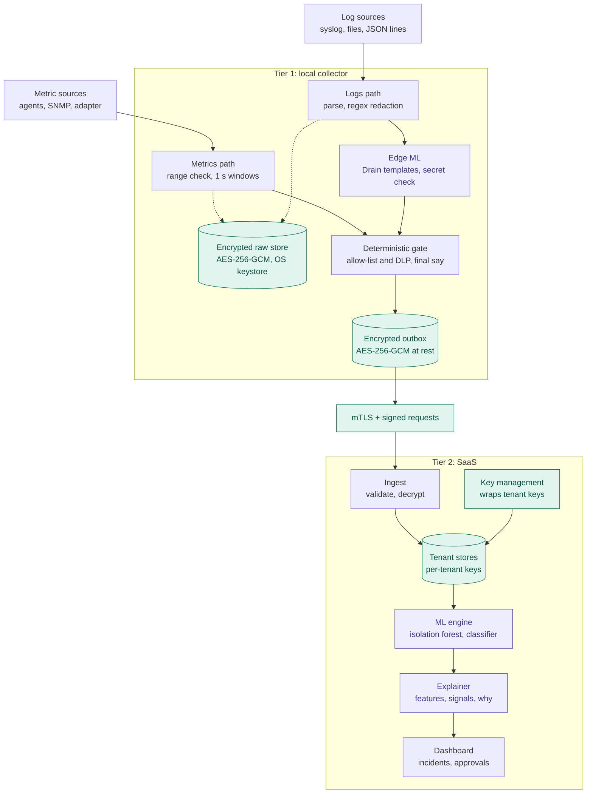

# ML models and encryption: architecture

Extends the logs-and-metrics design ([LOGS_AND_METRICS.md](LOGS_AND_METRICS.md)) with machine-learning
models for segregating and analysing telemetry, and encryption for data at rest and in transit.

**Assumption to confirm:** "segregate" is read here as grouping log lines into templates and classifying
incidents and templates into categories (network, resource, security, deploy). If the team means
separating sensitive from safe data, or tenants from each other, the edge ML and tenant-store parts
change; see "Rule for ML" below.

## Diagram

Purple: ML models. Teal: encryption. Grey: the existing core pipeline.

## Components

### ML models

| Component | Model | What it does | Why this model |
|---|---|---|---|
| Edge ML: templates | Drain (online log clustering) | Groups log lines into templates such as `payment gateway timeout after <*>ms`, with a hashed template ID | Needs no training data, runs in real time, standard in AIOps |
| Edge ML: secret check | Entropy score plus a small classifier on token features | Flags random-looking tokens the regexes miss, such as unknown API key formats | Catches what patterns miss; it can only **add** a redaction |
| ML engine: anomalies | Isolation Forest on several metrics at once, next to the existing z-score detector | Finds unusual combinations (for example error rate and latency both slightly high) that single-metric checks miss | Each decision can be traced to the features that isolated the point |
| ML engine: classification | Logistic regression or a small decision tree | Sorts incidents and log templates into network, resource, security, deploy | The features and weights behind each label can be shown |
| Explainer | Feature attribution for the models above | Shows, for each flag, the contributing signals, their values against baseline, and the reasoning | Phase 4 weights explainability highest |

**Rule for ML:** a model may decide what to look at, never what is allowed to leave the collector. The
deterministic allow-list and DLP gate keeps the final say, so a model's mistake can cause extra
redaction but never a leak.

**Measured, not claimed:** each model is trained and evaluated with `tools/benchmark.py`'s labelled
faults. A model ships only if precision and recall across seeds improve on the current ranges
(precision 94-97%, recall 92-100%).

### Encryption

| Layer | Algorithm and keys | Protects against |
|---|---|---|
| Encrypted raw store and outbox (collector) | AES-256-GCM; key held by the OS keystore (Windows DPAPI or a TPM) | A stolen disk or copied database file on the customer side |
| mTLS + signed requests (in transit) | TLS 1.2+ with mutual authentication; short-lived per-collector certificates issued at enrolment; HMAC-SHA256 request signing kept for replay protection | Eavesdropping, impersonated collectors, replayed requests; removes shared secrets from config files |
| Tenant stores (SaaS) | Envelope encryption: an AES-256-GCM data key per tenant, wrapped by a master key in key management | A leaked SaaS database; deleting a tenant's key makes its data unreadable |
| Field-level (optional) | Tenant-held key for fields the SaaS only stores, such as approved template labels | The SaaS operator reading fields it never needs to analyse |

Rules: use vetted libraries only (Python's `cryptography` package for AES-GCM; this adds a dependency to
a project that is currently standard-library only). Never design our own algorithm. Keys are rotated
on a schedule, with old data re-wrapped rather than re-encrypted. The SaaS must still be able to decrypt
what it analyses, so end-to-end encryption is used only for fields it merely stores.

## Order of work

1. Encrypted raw store and outbox on the collector, plus mutual TLS. Closes the "secrets in config
   files" limitation and is easy to demonstrate.
2. Drain template mining (step L2 of the logs plan).
3. Isolation Forest beside the z-score detector, measured with the benchmark; kept only if it improves.
4. Incident and template classifier with the explainer.
5. Per-tenant envelope encryption and key rotation at the SaaS.
